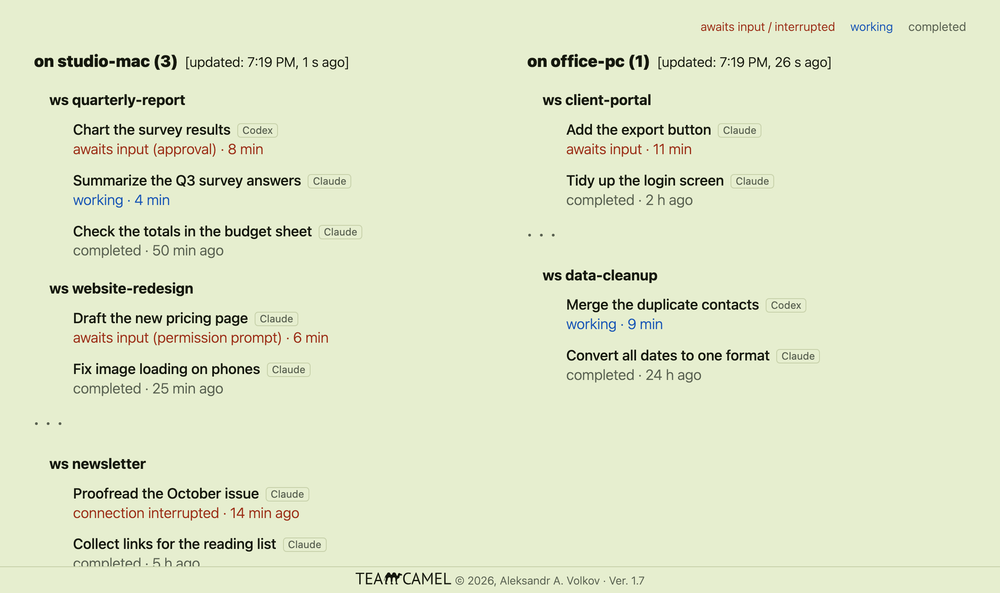

**One web page that shows which of your Claude Code and Codex sessions need you, on all your computers.**

When you run many [Claude Code](https://claude.com/product/claude-code) sessions in many folders, it is easy to
miss the one that has been waiting for your answer. TeamCamel puts them all on one page and sorts them so that
whatever needs you is on top. If you also use OpenAI's Codex, its sessions are on the same page, and each session
carries a small "Claude" or "Codex" label.

- **Awaits input** and **interrupted** sessions come first, in red. **Working** sessions are blue. **Completed**
  ones follow, most recent first; older ones fold away under ". . .".
- The count of sessions needing you is next to each computer's name and at the front of the browser tab's title.
- Click a session's name to open it in Claude or in the Codex app.
- Several computers on one page: the left column is the computer you are at, the right one shows the others.
- It reads Claude Code's and Codex's own files on your computer. **No tokens, no account, nothing sent anywhere.**
  The page is served to your own computer only.

## You need

- macOS, Windows or Linux
- Claude Code, used at least once: the Code tab of the Claude desktop app, or the `claude` command in a terminal
- Python 3.9 or newer
- Optional: Codex (the desktop app or the `codex` command). Nothing to set up; if it is there, its sessions show.

## Install

1. Download the zip from the [latest release](../../releases/latest) and unzip it. Put the `TeamCamel` folder
   where it can stay.
2. Run the precheck. It changes nothing and tells you if anything is missing.
   - macOS / Linux: in a terminal, inside the folder: `sh precheck.sh`
   - Windows: double-click `precheck.bat`
3. Install and start, once: `python3 teamcamel.py --install-hook` (on Windows: `python teamcamel.py --install-hook`).
   This adds one start-up line to Claude's settings file, after saving a backup of it, so that TeamCamel starts
   with every Claude session.
4. Open <http://127.0.0.1:2263/> and bookmark it.

`README.txt` in the zip has the same steps in more detail.

## Several computers

Keep the `TeamCamel` folder inside a folder that syncs between your computers (Dropbox, OneDrive, iCloud Drive)
and do step 3 on each. Every computer's page then shows all of them. The computers never talk to each other
directly: each one writes a small report file into the shared folder.

## Commands

| Command | What it does |
|---|---|
| `sh precheck.sh` / `precheck.bat` | Says whether anything TeamCamel needs is missing |
| `python3 teamcamel.py --install-hook` | One-time setup; also starts it |
| `python3 teamcamel.py --check` | Reports what TeamCamel finds on this computer |
| `python3 teamcamel.py --stop` | Stops it until the next Claude session |
| `python3 teamcamel.py --uninstall` | Takes it out of Claude's start-up and stops it |

## Good to know

- It shows Claude Code sessions that run on your computers. It does not show cloud sessions, ordinary claude.ai
  chats or Cowork sessions.
- For Codex, TeamCamel works the state out from the session's transcript, because Codex publishes no live
  status. "Awaits input" is recognized when a command asks for wider permissions or Codex asks a question; another
  kind of prompt may show as "working". TeamCamel starts with Claude Code, so on a computer that has only Codex
  you start it yourself (`python3 teamcamel.py`).
- It relies on files whose form Anthropic and OpenAI may change with any update. If an update breaks it, look for
  a newer release here.
- Tested on macOS and Linux. Windows support is new and has not yet been confirmed on a real Windows computer;
  reports are welcome under [Issues](../../issues). The output of the precheck and of `--check` lists counts and
  folder names only, never session names, so it is safe to post.
- It is two plain files, `teamcamel.py` and `web/index.html`, with no other parts to install. Change them as you
  like; a running copy picks up a changed file by itself.

## License and credits

Free to use, copy, change and share. It may not be sold, nor may a product or service whose value comes mainly
from it. The terms are the MIT License with the Commons Clause: see [LICENSE.txt](LICENSE.txt).
Copyright (c) 2026 Aleksandr A. Volkov. Version history: [CHANGELOG.txt](CHANGELOG.txt).

The lettering of the logo is traced from PT Sans by ParaType, a free font.

TeamCamel is an independent project. It is not made or endorsed by Anthropic or OpenAI. Claude is a trademark of
Anthropic; Codex is a product of OpenAI.
