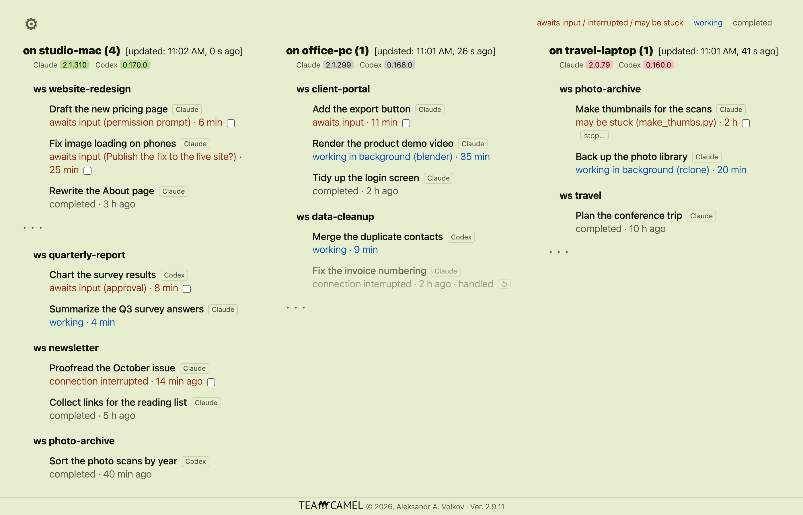
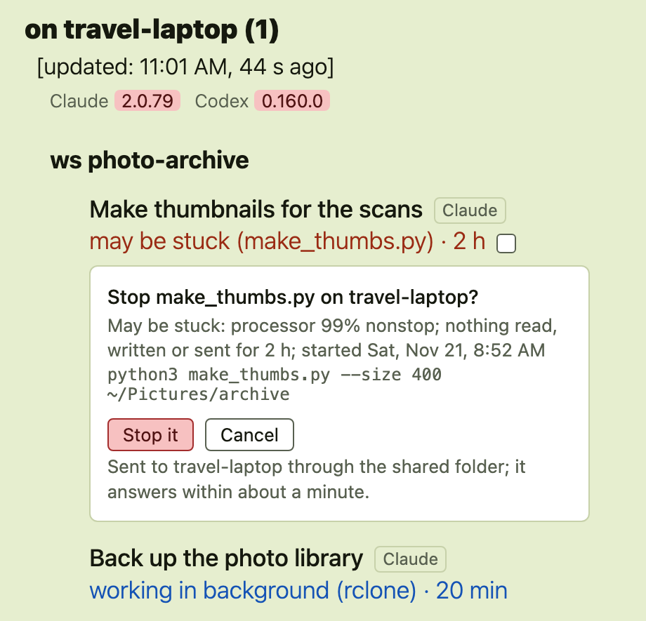
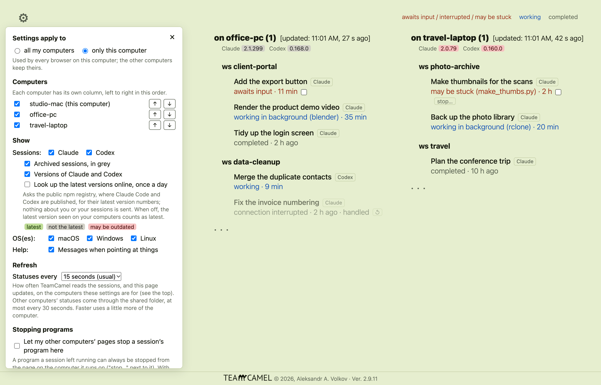

**One web page that shows which of your Claude Code and Codex sessions need you, on all your computers.**

When you run many [Claude Code](https://claude.com/product/claude-code) sessions in many folders, it is easy to
miss the one that has been waiting for your answer. TeamCamel puts them all on one page and sorts them so that
whatever needs you is on top. If you also use OpenAI's Codex, its sessions are on the same page, and each session
carries a small "Claude" or "Codex" label.

- **Awaits input** (a prompt, or a turn that ended with a question to you, including the app's closing card with answer buttons) and **interrupted** sessions come first, in red. **Working** sessions are blue. **Completed**
  ones follow, most recent first; older ones fold away under ". . .".
- A session whose turn is over while work it started still runs shows as **working in background**: a command or
  helper agent Claude sent to the background, or a busy program the session started, such as a render, a copy or an
  upload. A program started again later (by you, a scheduled job or a script) still counts: it belongs to the session
  whose commands named its script in the last 14 days. Point at it to see which program, since when, and its command.
- A program a session left running that has used the processor nonstop for an hour, reading, writing and sending
  nothing, shows in red as **may be stuck**. "stop…" next to it (or next to any session working in background) stops
  that program after asking you: only programs TeamCamel shows as a session's work, never anything else. Stopping a
  program on another of your computers is a setting, off until you turn it on. 
  
- The count of sessions needing you is next to each computer's name and at the front of the browser tab's title.
- Click a session's name to open it in Claude or in the Codex app.
- Sessions are grouped by the folder they work in ("ws" and the folder's name). Two folders with the same name, say
  two projects each kept in a folder called `workspace`, stay apart: each label then also names the folder it sits
  in.
- Grey sessions never count as needing you: archived ones, ones whose folder was deleted, and ones you marked handled
  by ticking the small square next to them (until they do something new). A session whose folder was renamed or moved
  carries on under the folder's new name: TeamCamel follows the folder.
- Several computers on one page, each in its own column; the one you are at comes first unless the settings say
  otherwise. Small blinking arrows point to sessions out of view, blue for working and red for needing you: up and
  down just left of each computer's column, for that column's sessions; left and right at the top, for columns out
  of view. Clicking one brings the session into view.
- Under each computer's name, the Claude Code and Codex versions it runs: green for the latest, grey for not the
  latest, red for may be outdated.
- The gear at the top left opens the settings: which computers and apps to show and in what order, how often
  statuses refresh, colors, the versions, and a pop-up, sound or blinking tab title when a session starts needing you. They apply to all your
  computers or only the one you are at (in every browser on it), as you choose.
- It reads Claude Code's and Codex's own files on your computer. **No tokens, no account, nothing sent anywhere.**
  The one optional exception, off until you turn it on in the settings: a daily look-up of the latest version
  numbers at the public npm registry.
  The page is served to your own computer only.

## You need

- macOS, Windows or Linux
- Claude Code, used at least once: the Code tab of the Claude desktop app, or the `claude` command in a terminal
- Python 3.9 or newer
- Optional: Codex (the desktop app or the `codex` command). Nothing to set up; if it is there, its sessions show.

## Install

1. Download the zip from the [latest release](../../releases/latest) and unzip it. Put the `TeamCamel` folder
   where it can stay. To see several computers on one page, put it inside a folder that syncs between them
   (see [Several computers](#several-computers)).
2. Run the precheck. It changes nothing and tells you if anything is missing.
   - macOS / Linux: in a terminal, inside the folder: `sh precheck.sh`
   - Windows: double-click `precheck.bat`
3. Install and start, once: `python3 teamcamel.py --install-hook` (on Windows: `python teamcamel.py --install-hook`).
   This adds one start-up line to Claude's settings file, after saving a backup of it, so that TeamCamel starts
   with every Claude session.
4. Open <http://127.0.0.1:2263/> and bookmark it.
5. Optional, only if you want it: `python3 teamcamel.py --start-at-login` makes TeamCamel also start by itself
   when you log in (so its page is up after a restart, before any Claude session) and start again if it ever
   stops. It adds a login item: on macOS a LaunchAgent in `~/Library/LaunchAgents`, on Linux a systemd user
   service, on Windows a file in the Startup folder. On a Mac the LaunchAgent starts a small helper app that
   TeamCamel builds there, in `~/Library/Application Support/TeamCamel`, from the C source it carries: macOS
   lets an app, but not a bare script started at login, into a cloud-storage folder such as Dropbox, once you
   allow it. When the folder is in such a place, macOS asks once whether "TeamCamel" may access it: click
   Allow. `--no-start-at-login` takes it all away. Nothing starts by itself after a restart unless you ask for
   this.

Or double-click `web/index.html` in the folder: it shows these steps in your browser, with the commands for your
folder ready to copy, and tells you when TeamCamel is running. `README.txt` in the zip has the same steps in more
detail.

## Several computers

Keep the `TeamCamel` folder inside a folder that syncs between your computers (Dropbox, OneDrive, iCloud Drive)
and do step 3 on each. Every computer's page then shows all of them. The computers never talk to each other
directly: each one writes a small report file into the shared folder.

## Commands

| Command | What it does |
|---|---|
| `sh precheck.sh` / `precheck.bat` | Says whether anything TeamCamel needs is missing |
| `python3 teamcamel.py --install-hook` | One-time setup; also starts it |
| `python3 teamcamel.py --check` | Reports what TeamCamel finds on this computer |
| `python3 teamcamel.py --start-at-login` | Optional: also starts it when you log in, and again if it stops (adds a login item) |
| `python3 teamcamel.py --no-start-at-login` | Takes that login item (and the Mac helper app) away |
| `python3 teamcamel.py --stop` | Stops it until the next Claude session (or the next login, with the login item) |
| `python3 teamcamel.py --uninstall` | Takes it out of Claude's start-up and the login item, and stops it |

## Good to know

- It shows Claude Code sessions that run on your computers. It does not show cloud sessions, ordinary claude.ai
  chats or Cowork sessions.
- For Codex, TeamCamel works the state out from the session's transcript, because Codex publishes no live
  status. "Awaits input" is recognized when a command asks for wider permissions or Codex asks a question; another
  kind of prompt may show as "working". TeamCamel starts with Claude Code, so on a computer that has only Codex
  you start it yourself (`python3 teamcamel.py`).
- When a computer shuts down, restarts or logs out, its TeamCamel leaves a last word: the other computers' pages
  say "TeamCamel stopped at 9:23 PM: shutting down, restarting or logging out" (if the synced folder sends it
  before it closes), rather than only "not reporting".
- When TeamCamel is not running on the computer you are at, the bookmarked page says so, with the command to
  start it, instead of the browser's "cannot connect". This works in Chrome; other browsers may show their own
  message instead (Safari's support for it on a local address is uncertain).
- It relies on files whose form Anthropic and OpenAI may change with any update. If an update breaks it, look for
  a newer release here.
- Tested on macOS and Linux. Windows support is new and has not yet been confirmed on a real Windows computer;
  reports are welcome under [Issues](../../issues). The output of the precheck and of `--check` lists counts and
  folder names only, never session names, so it is safe to post.
- It is two plain files, `teamcamel.py` and `web/index.html`, with no other parts to install. Change them as you
  like; a running copy picks up a changed file by itself.

## License and credits

Free to use, copy, change and share. It may not be sold, nor may a product or service whose value comes mainly
from it. The terms are the MIT License with the Commons Clause: see [LICENSE.txt](LICENSE.txt).
Copyright (c) 2026 Aleksandr A. Volkov. Version history: [CHANGELOG.txt](CHANGELOG.txt).

The lettering of the logo is traced from PT Sans by ParaType, a free font.

TeamCamel is an independent project. It is not made or endorsed by Anthropic or OpenAI. Claude is a trademark of
Anthropic; Codex is a product of OpenAI.
